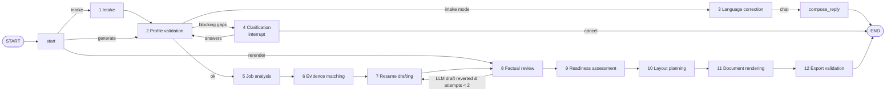

# 🌈 CareerRainbow AI — Agentic CV & Resume Studio

## Resume copilot and reliable exports

Open **Resume copilot** to collect career facts conversationally and run the per-session workflow. Natural-language actions include:

- `review my profile` — inspect required facts and malformed imported fields.
- `use GIS & GeoAI Professional template` — select a named design.
- `generate my resume` — validate, match, draft, fact-check and export.
- `preview my resume` — open the editing and preview workspace.

Configure a supported AI provider and grant processing consent in the sidebar for AI extraction and rewriting. Without a provider, the assistant explicitly uses deterministic offline guidance and the same validation/export workflow.

Changing a template or its options invalidates the old PDF/DOCX. Regenerate before downloading so the export matches the selected design. Structurally suspicious imports (a whole paragraph in a location or an oversized Skills field) are held for review rather than silently exported. Fix these in **Add information → Form**, or import the original document again; existing corrupted fields are not guessed or overwritten.

The robot-document logo represents the resume copilot; rainbow accents match the rest of the application family. The logo is used in the sidebar, chat and browser icon.


A Streamlit app that turns a conversation, a form or an existing resume into an accurate, tailored,
well-laid-out resume in **15 designs**, exported to **PDF and DOCX** from one structured model,
with a transparent readiness score. It runs **fully offline** with a deterministic engine, and can
optionally use an LLM (OpenAI, Anthropic or any OpenAI-compatible endpoint) through LangChain.

> **Accuracy rule:** the app never invents employment, qualifications, dates, skills, certifications,
> references or numbers. Generated text is fact-checked against your profile; unsupported changes are reverted.

---

## Architecture

```
Streamlit UI (9 steps)  ──►  WorkflowRunner (per session)  ──►  LangGraph StateGraph
   chat · form · upload        own graph + InMemorySaver            typed ResumeState
   one CandidateProfile        + random thread_id                   explicit conditional edges
```



| Layer | Where | Responsibility |
|---|---|---|
| Models | `src/models/` | Pydantic `CandidateProfile`, `ResumeDocument`, job/match/correction models |
| Agents | `src/agents/` | Node logic: intake, validation, correction, job analysis, matching, drafting, factual review, layout |
| Graph | `src/graph/` | Typed state, nodes, routing, compiled graph, per-session runner |
| Prompts | `src/prompts/` | LangChain `ChatPromptTemplate`s with guardrails; untrusted data is fenced |
| Services | `src/services/` | LLM integration (structured output, bounded retries), extraction, parser, taxonomy, spelling |
| Templates | `src/templates/` | 15 `TemplateSpec`s + `RenderOptions` |
| Rendering | `src/rendering/` | Shared ReportLab PDF + python-docx engines, fonts, export validation |
| Scoring | `src/scoring/` | Resume Readiness Score |
| Security | `src/security/` | Credential checks, upload validation, prompt-injection fencing |
| UI | `src/ui/` | Theme, components, session state, sidebar, one module per step |

**How the LLM is used (optional).** Each LLM-capable node calls `LLMService.structured()` →
`prompt | model.with_structured_output(PydanticSchema)`. Transient failures (rate limits, timeouts,
5xx) retry at most **2** times with backoff; malformed output gets **1** corrective retry; auth errors
are not retried. On any failure the node falls back to the deterministic engine and the user sees a
visible notice — failures are never hidden. LLM output is then constrained by code:
match claims must cite real evidence IDs, imports are checked word-for-word against the source
document, and drafts go through factual review. Chain-of-thought is never requested or shown;
the UI shows short progress messages.

**Offline engine (default).** Rule-based resume parsing, a curated misspelling dictionary plus
pyspellchecker *suggestions*, a 10-sector taxonomy with synonyms and skill families for job analysis
and matching, and fact-only summary composition. Everything works without an API key.

## Features at a glance

- **Three entry points, one profile:** chat (focused questions, each field asked at most twice, `skip` supported),
  structured forms, upload of text PDF/DOCX/TXT, and JSON profile re-import. Completion progress is always visible.
- **Corrections with control:** routine fixes applied automatically (e.g. *mange GIS databse* → *Managed GIS database*,
  *Pythn programing* → *Python programming*), shown as a diff with explanation; **accept / reject / undo**.
  Names, employers, institutions, certification titles, technical terms, numbers and URLs are protected.
  Anything that could change a fact (skill names, dictionary guesses, LLM rewrites that alter numbers or names)
  waits for confirmation.
- **Fact checks:** contradictory dates, current-with-end-date roles, missing institutions/employers,
  malformed emails, incomplete LinkedIn/GitHub links, referees without permission.
- **Job tailoring** across GIS/Remote Sensing/GeoAI, AI/ML & Data Science, Software Engineering, Analytics & BI,
  Civil/BIM, Project Management, Healthcare, Finance, Education, Sales/Marketing/Admin. Requirements are classed as
  **supported / transferable / not demonstrated / needs clarification**. Unsupported keywords are never inserted.
  Bullets without results prompt the candidate for the *real* figure.
- **15 templates** (Classic ATS, Modern Professional, Compact Executive, Graduate Starter, Technical Engineer,
  AI & Data Specialist, GIS & GeoAI Professional, Project Manager, Finance Professional, Healthcare Professional,
  Academic & Research, Career Transition, International Professional, Minimal Elegant, Creative Portfolio) with live
  thumbnails, recommended occupations, page-length options, parsing notes and customisation (paper, length, font,
  accent colour, 10.5/11 pt, left/justified, date style, section order/visibility, max points per role).
  The two multi-column designs are labelled **presentation-oriented** and always ship with a separate single-column
  parsing-friendly PDF + DOCX.
- **Page fitting without data loss:** tighter spacing → narrower margins → (last resort) 10 pt minimum. If content
  still doesn't fit, the extra page is kept and specific trimming suggestions are shown. Headings stay with their
  content; entries are kept together where possible.
- **Export validation** re-opens both files: text extractable, expected text present, reading order, page count,
  blank/clipped pages, name and contact intact, no unsupported numbers.
- **Privacy:** in-memory processing, explicit consent before any text goes to an LLM provider,
  **Clear my session and files**, keys never logged or displayed.

## Resume Readiness Score

> *This is an internal readiness assessment, not a score from an employer's ATS. Results vary across systems and job requirements.*

Each component starts at its maximum and loses points only for explained findings. Every deduction lists a fix.

| Component | Max | Deterministic checks (examples) |
|---|---|---|
| Parsing & document structure | 25 | presentation layout (−8), non-standard headings, missing contact, unparseable dates; after export: text extraction, reading order, missing text |
| Job relevance supported by evidence | 30 | weighted coverage: required ×2, preferred ×1; supported = 1, skills-list-only = 0.75, transferable = 0.5, needs clarification = 0.25. **Unavailable without a job description.** Labelled *estimate* if any match was AI-assisted |
| Completeness & consistency | 20 | missing education/skills/experience, roles without points or dates, very thin detail, unresolved blocking issues, warnings |
| Clarity & language | 15 | weak openings, pronouns, over-long/very short points, repeated verbs, non-action openings, unconfirmed suggestions, few measurable details |
| Layout & readability | 10 | exceeds page target, reduced font, tight spacing, blank/clipped pages, sparse last page. **Available after rendering** |

When a component is unavailable the score is shown out of the available maximum (e.g. 60 or 70), never as a full 100.

---

## Requirements

- **Python 3.12** (tested on **3.12.3**). 3.11 should work but was not tested.
- **No system packages or external binaries.** Fonts (OFL/DejaVu licences, see `assets/fonts/FONT_LICENSES.md`)
  are bundled; PyMuPDF ships prebuilt wheels. **OCR is not included**: scanned PDFs are detected and the user is
  asked for a text-based file; PNG/JPG uploads are refused with an explanation.
- Optional: LibreOffice is *not* required; it was only used during development to visually check DOCX output.

## Run locally on Windows (PowerShell)

```powershell
# 1. Create and activate a virtual environment
cd career_rainbow_ai
py -3.12 -m venv .venv
.\.venv\Scripts\Activate.ps1
# If activation is blocked:  Set-ExecutionPolicy -Scope CurrentUser RemoteSigned

# 2. Install dependencies
python -m pip install --upgrade pip
pip install -r requirements.txt

# 3. Configure credentials (optional — skip to run fully offline)
Copy-Item .streamlit\secrets.toml.example .streamlit\secrets.toml
notepad .streamlit\secrets.toml        # set LLM_PROVIDER and the matching API key
#    or use environment variables for this shell only:
$env:LLM_PROVIDER = "openai"; $env:OPENAI_API_KEY = "sk-..."
#    or copy .env.example to .env and edit it

# 4. Run tests
python -m pytest -q

# 5. Launch
streamlit run app.py
```

Command Prompt (`cmd.exe`) differences: activate with `.venv\Scripts\activate.bat`, copy with
`copy .streamlit\secrets.toml.example .streamlit\secrets.toml`, set variables with `set OPENAI_API_KEY=sk-...`.

macOS/Linux: `python3.12 -m venv .venv && source .venv/bin/activate`, then the same `pip`, `pytest` and `streamlit` commands.

You can also paste an API key into the sidebar (**⚙️ AI provider**). It is kept only in that session's memory.
Use **Test connection** to verify it. Keys with leading/trailing whitespace, internal spaces, smart quotes or
other non-ASCII characters are **reported, not silently fixed** — correct the key at its source.

## Deploy to Streamlit Community Cloud

1. Create a GitHub repository and push the project (secrets are excluded by `.gitignore`):
   ```powershell
   git init
   git add .
   git commit -m "CareerRainbow AI"
   git branch -M main
   git remote add origin https://github.com/<you>/career-rainbow-ai.git
   git push -u origin main
   ```
2. Go to <https://share.streamlit.io>, sign in with GitHub, choose **Create app → Deploy a public app from GitHub**.
3. Select the repository, branch `main`, main file `app.py`.
4. Open **Advanced settings**, choose **Python 3.12**, and paste your secrets in TOML form
   (see `.streamlit/secrets.toml.example`). Leave secrets empty to deploy in offline mode.
5. Deploy. The bundled `.streamlit/config.toml` applies the rainbow light/dark themes and a 5 MB upload limit.

**If you deploy with your own API key**, every visitor's requests use it and are billed to you. Visitors must still
tick the consent box before any of their text is sent to the provider. Consider leaving the provider as `none`
and letting visitors enter their own key in the sidebar.

## Persistence: development vs hosted

- Each browser session owns a `WorkflowRunner` with its own LangGraph `InMemorySaver` and random `thread_id`.
  The checkpointer keeps a paused run (a clarification `interrupt`) alive across Streamlit reruns; completed runs are
  deleted from it to keep memory bounded. The profile, chat and results live in that session's `st.session_state`.
- **Locally and on Community Cloud this state is in server memory only.** Refreshing the page starts a new session,
  and an app restart or idle shutdown clears everything. That is deliberate: candidate data is not retained.
  Use **Download → profile (JSON)** to save work and re-import it later.
- For durable or multi-instance hosting, swap `InMemorySaver` for a database checkpointer (e.g.
  `langgraph-checkpoint-postgres`) keyed by an authenticated user ID — never by an API key — and add encryption at rest
  and a retention policy. This is not included.

## Privacy & security

- Uploads are validated (extension, size, file signature, DOCX zip bomb limit) and processed in memory; no candidate
  file is written to disk, so there are no temp files to leak. Generated PDF/DOCX bytes live only in the session.
- Resume text, chat messages and job descriptions are treated as **data**: they are fenced in prompts, look-alike fence
  tags are neutralised, and prompts instruct the model to ignore embedded instructions. LLM results are additionally
  constrained by code (evidence-ID validation, factual review).
- API keys come from environment variables or Streamlit secrets, are never logged, and are displayed only as
  "(set, N characters)". Error messages report the error type, never the key.
- Sensitive details (photo, date of birth, ID numbers, religion, marital status) are not collected.

## Tests

`python -m pytest -q` runs **91 tests** in about 10 seconds:

| File | Covers |
|---|---|
| `test_profile_validation.py` | required fields, malformed email, date contradictions, missing institutions, incomplete links, international names, skipped fields, referee permission |
| `test_corrections.py` | spec examples, protected names/numbers/URLs, pending vs applied, reject/re-suggest, edit-conflict safety |
| `test_matching_and_review.py` | supported/transferable/not-demonstrated, no false matches, years from dates, unsupported keywords not inserted, invented claims reverted, user edits flagged |
| `test_scoring.py` | relevance unavailable without JD, totals = components − deductions, weak profiles score low, weighting, estimate labels, layout component |
| `test_rendering.py` | all 15 templates render PDF+DOCX and pass validation, overflow reported without truncation, 2-page fit, Letter size, international names in PDF/DOCX, content parity, tamper detection, DOCX column widths |
| `test_graph.py` | full generation, clarification interrupt/resume/cancel, **session isolation**, no retention after completion, chat intake never repeats, re-render flags edits |
| `test_llm.py` | **malformed LLM responses**, bounded retries, auth not retried, fallback with visible error, evidence-ID enforcement, import verification, credential checks |
| `test_extraction.py` | PDF/DOCX round-trip import, scanned PDF detection, messy TXT parsing, upload validation, injection fencing |
| `test_app.py` | headless Streamlit `AppTest`: every step renders, full sample flow, chat turn, two isolated sessions, clear session |

## Project structure

```
career_rainbow_ai/
├── app.py                      Streamlit entry point
├── requirements.txt            pinned, tested versions
├── .streamlit/config.toml      light + dark rainbow themes, 5 MB uploads
├── .streamlit/secrets.toml.example
├── .env.example
├── assets/fonts/               bundled open-licence TTFs + licences
├── examples/                   fictional candidates, job descriptions, sample_output/
├── src/
│   ├── config.py
│   ├── models/      profile.py resume.py job.py corrections.py paths.py
│   ├── agents/      intake validation correction job_analysis matching drafting factual_review layout
│   ├── graph/       state.py nodes.py builder.py runner.py
│   ├── prompts/     templates.py
│   ├── templates/   registry.py (15 designs)
│   ├── rendering/   pdf_renderer docx_renderer fonts common export_validation
│   ├── scoring/     readiness.py
│   ├── services/    llm extraction heuristic_parser chat_intake correction taxonomy dates text_utils
│   ├── security/    credentials uploads untrusted
│   └── ui/          theme components state sidebar steps/
└── tests/
```

## Verification performed before delivery

**Executed:**
- 91/91 tests pass, both in the development environment and in a **fresh virtual environment** installed only from
  `requirements.txt` (`pip check`: no broken requirements). Python 3.12.3, Linux.
- `pyflakes` reports no issues across `app.py`, `src/` and `tests/`.
- `streamlit run app.py` starts and the health endpoint returns 200.
- The real UI was driven in headless Chromium (Playwright): load sample → corrections → template gallery → generate →
  validate, in light and dark mode. Screenshots were inspected; bugs found this way (score ring, colour-only badges)
  were fixed.
- All 15 templates rendered and inspected visually as PDF images; sample PDF and DOCX files were generated
  (`examples/sample_output/`) and the DOCX files were visually checked by converting them with LibreOffice, which found
  and led to fixing a sidebar column-width bug.

**Not executed:**
- **No real LLM provider was called** (no API key available). The LLM path is covered by tests with a fake chat model
  (structured output, malformed responses, retries, auth errors, fallbacks), but real-provider behaviour — schema
  compliance, latency, cost, model names — is untested. Default model names may need updating.
- Not tested on Windows, on Streamlit Community Cloud itself, in Microsoft Word, or with screen readers.
- No load testing with many concurrent users.

## Known limitations

- **Offline correction is dictionary-based.** It fixes known misspellings and the opening verb's tense, but not
  context such as singular→plural (*databse* → "database", whereas an LLM would produce "databases"). Unknown-word
  guesses are only suggestions.
- **Offline parsing of uploads is heuristic.** Unusual layouts (tables, columns, creative PDFs) may be misread;
  always review imported data. AI-assisted import is better but still flagged for confirmation.
- **Job matching is keyword/taxonomy based** offline; requirements outside the taxonomy are matched by wording and
  usually marked *needs clarification*. The relevance score is a guide, not a prediction of any employer's ATS.
- **DOCX pagination is decided by Word** on the reader's computer; the DOCX mirrors the PDF's margins and sizes and
  uses metric-compatible fonts (Calibri, Cambria, Arial, Times New Roman), but page breaks can differ slightly.
  The Creative Portfolio DOCX requests *Century Gothic* and falls back to a system font where it is missing.
- **Scripts:** bundled fonts cover Latin, Greek and Cyrillic. CJK, Arabic and Indic names are not fully supported in the
  PDF (the app warns when characters are missing). Right-to-left layout is not implemented.
- **No OCR.** Scanned resumes must be converted to text first.
- **In-memory state** (see *Persistence*): refreshing the page starts over unless the JSON profile is saved.
- The sidebar templates place contact details in a side column; use their parsing-friendly export for portals.

All sample people, employers and job postings in `examples/` are fictional.
